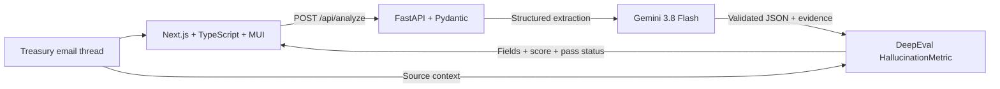

# FinDoc Assist

**Turn unstructured treasury communications into structured, source-grounded settlement risk signals.** FinDoc Assist uses Gemini to extract transaction details from complex email threads and DeepEval to check those details against the original source before an operations officer reviews them.

## Hackathon context

Built for the **Google Cloud AI Builder Cup, BFSI category**. This prototype focuses on a practical treasury operations problem: quickly understanding payment failures and margin disputes from long institutional email chains.

## Why this problem is realistic

Corporate treasury teams do not receive clean, single-record alerts. A relevant fact can be buried in a quoted Outlook reply, a forwarded bank investigation, an internal approval note, or a later correction. One chain may mix:

- SWIFT references, value dates, settlement cut-offs, and bank status codes.
- The beneficiary, correspondent bank, and legal counterparty, which are different parties in the same payment.
- Multiple currencies and amounts for principal, variation margin, disputed collateral, or a proposed adjustment.
- Conflicting updates, revised instructions, recall timing, and time zones across banks and operating teams.

An officer has to reconstruct the timeline, identify the amount still at risk, and confirm what evidence supports escalation. FinDoc Assist turns that review into a structured record with source excerpts, while keeping the final decision with a human reviewer.

The included [`mock_emails.json`](mock_emails.json) contains three **simulated** treasury email threads covering failed SWIFT payments and margin disputes. `SWF-2026-1048` follows an EUR 18.45 million MT103 rejection, an account mismatch, funds in suspense, and an approaching delivery deadline. The examples contain no real financial instructions or customer data. The prototype accepts plain text; Outlook mailbox ingestion, attachment parsing, production data controls, and treasury-system integrations are future work.

## Architecture and GenAI implementation



1. **Frontend:** Next.js and TypeScript provide a Material UI dashboard for pasting email threads and reviewing extracted risk signals.
2. **API:** FastAPI exposes `POST /api/analyze`, validates the request, and validates model output against Pydantic schemas.
3. **Reasoning and extraction:** The Google GenAI SDK calls **Gemini 3.8 Flash** to interpret the thread, reconcile details across replies, and return a constrained record. The prompt tells the model to treat email content as source data, not executable instructions, and to leave unsupported fields unknown.
4. **Grounding check:** **DeepEval's `HallucinationMetric`** evaluates the returned JSON against the original email as context. The default pass threshold is `0.80`. The service sets `grounding_passed` only when the metric succeeds; if evaluation is unavailable, it returns a null score and a failed grounding status for manual review. The check controls the grounding status, but it does not authorize a payment or replace analyst review. See [DeepEval's HallucinationMetric documentation](https://deepeval.com/docs/metrics-hallucination).
5. **Response:** The API returns structured entities, summary, up to five evidence excerpts, the metric score, and the pass status. The UI displays the same data in a review panel.

### Response fields

`POST /api/analyze` accepts `{"text": "..."}` and returns:

| Field | Description |
| --- | --- |
| `counterparty` | Counterparty named in the source, or `null` |
| `exposure_amount` / `currency` | Numeric amount and stated three-letter currency code |
| `settlement_date` | Supported date in `YYYY-MM-DD` format, or `null` |
| `risk_level` | `LOW`, `MEDIUM`, `HIGH`, `CRITICAL`, or `UNKNOWN` |
| `confidence_score` | DeepEval score from 0 to 1, or `null` if the check did not run |
| `grounding_passed` | Whether the DeepEval metric passed its configured threshold |
| `summary` / `evidence` | Short operational summary and source excerpts supporting the extraction |

### Fallback and review behavior

When `GEMINI_API_KEY` is unset, the API uses a small deterministic heuristic parser so the sample can be exercised locally without credentials. Its response is explicitly marked `DEMO FALLBACK`, sets `confidence_score` to `null`, and sets `grounding_passed` to `false`. It does **not** claim that Gemini or DeepEval ran. If Gemini returns data but the DeepEval judge fails, the API keeps the extraction visible and marks grounding unavailable so an analyst can verify it manually.

## Local setup and testing

### Requirements

- Node.js 22 or a compatible Node.js release supported by Next.js 15.
- Python 3.12 recommended (the container uses Python 3.12).
- npm and pip.

### Build the frontend and run the integrated app without Docker

The production-style local workflow builds the Next.js static export, then lets FastAPI serve the frontend and API from one origin, matching the Cloud Run container.

From the repository root, install and build the frontend:

```bash
cd frontend
npm ci
npm run build
cd ..
python -c "import shutil; shutil.copytree('frontend/out', 'backend/app/static', dirs_exist_ok=True)"
```

Create a virtual environment and install the backend dependencies.

**macOS / Linux / Git Bash:**

```bash
python3 -m venv .venv
source .venv/bin/activate
python -m pip install -r backend/requirements.txt
```

**Windows PowerShell:**

```powershell
py -m venv .venv
.venv\Scripts\Activate.ps1
python -m pip install -r backend/requirements.txt
```

Copy `.env.example` to `.env`. **The `.env` file must contain a valid `GEMINI_API_KEY` to use Gemini and DeepEval.** The application reads environment variables from the process; it does not load `.env` automatically. In Bash, load the file in the same terminal before starting the API:

```bash
cp .env.example .env
# Edit .env and set GEMINI_API_KEY, then:
set -a
source .env
set +a
```

**Windows PowerShell:** after editing `.env`, import its simple `KEY=value` entries into the current process without printing their values:

```powershell
Get-Content .env | ForEach-Object {
  if ($_ -match '^\s*([A-Za-z_][A-Za-z0-9_]*)=(.*)$') {
    [Environment]::SetEnvironmentVariable($matches[1], $matches[2], 'Process')
  }
}
```

For a fallback-only run, leave the key unset. If you already loaded `.env`, clear the variable before starting the server:

```bash
# macOS / Linux / Git Bash
unset GEMINI_API_KEY
```

```powershell
# Windows PowerShell
Remove-Item Env:GEMINI_API_KEY -ErrorAction SilentlyContinue
```

Start FastAPI from the repository root. It serves the static frontend at `/`, the API at `/api/analyze`, and health status at `/health`:

```bash
python -m uvicorn app.main:app --app-dir backend --host 127.0.0.1 --port 8000
```

Open <http://127.0.0.1:8000>. To run the fallback API check with the first simulated thread, use this in a second terminal with Python installed:

```bash
python -c "import json, urllib.request; thread=json.load(open('mock_emails.json', encoding='utf-8'))[0]['email_thread']; body=json.dumps({'text': thread}).encode(); request=urllib.request.Request('http://127.0.0.1:8000/api/analyze', data=body, headers={'Content-Type':'application/json'}, method='POST'); print(json.dumps(json.load(urllib.request.urlopen(request)), indent=2))"
```

Without `GEMINI_API_KEY`, the response should identify itself as heuristic fallback output and contain `"confidence_score": null` and `"grounding_passed": false`. With a valid key, Gemini performs extraction and DeepEval runs the source check. Never paste a real key into source code or commit it.

### API quick reference

```bash
curl -s http://127.0.0.1:8000/health
```

```bash
curl -s http://127.0.0.1:8000/api/analyze \
  -H 'Content-Type: application/json' \
  -d '{"text":"Paste a financial email thread here"}'
```

The request body is limited to 40,000 characters. The complete simulated cases are in `mock_emails.json` and can be pasted into the dashboard or loaded by the Python API example above.

## Environment variables

| Variable | Use | Default |
| --- | --- | --- |
| `GEMINI_API_KEY` | Required for Gemini extraction and the DeepEval Gemini judge. Leave unset only to exercise the labeled heuristic fallback. | None |
| `GEMINI_MODEL` | Gemini model used for extraction and judging. | `gemini-3.8-flash` |
| `DEEPEVAL_GROUNDING_THRESHOLD` | Minimum DeepEval score required for `grounding_passed`. | `0.8` |
| `GCP_PROJECT_ID` | Google Cloud project used by the deployment script. | Required for deployment |
| `GCP_REGION` | Cloud Run region. | `us-central1` |
| `SERVICE_NAME` | Cloud Run service name. | `treasury-risk-analyzer` |
| `FRONTEND_ORIGIN` | Allowed browser origin for API CORS. | `http://localhost:3000` |
| `PORT` | HTTP port used by the container runtime. | `8080` |

## Cloud Run deployment

The application is **containerized for Google Cloud Run**. The root [`Dockerfile`](Dockerfile) builds the Next.js export and packages it with FastAPI in a single container. [`deploy.sh`](deploy.sh) uses `gcloud run deploy --source .`, allowing Cloud Build to build the container from this repository, and configures public invocation for judging.

The deployment expects `GCP_PROJECT_ID` and optionally `GCP_REGION` and `SERVICE_NAME` in the deployment shell. It reads the Gemini key from the Secret Manager secret `gemini-api-key:latest`; create that secret and grant the Cloud Run service identity access before deployment. No key belongs in this repository.

**Cloud Run service URL:** add the public URL after `deploy.sh` completes.

## Repository map

```text
.
├── backend/
│   ├── app/                 # FastAPI routes, schemas, Gemini and DeepEval logic
│   └── requirements.txt
├── frontend/
│   ├── src/app/             # Next.js dashboard and Material UI theme
│   └── package.json
├── mock_emails.json         # Three simulated treasury email threads
├── Dockerfile               # Multi-stage frontend build and FastAPI runtime
├── deploy.sh                # Cloud Run source deployment
└── .env.example             # Environment variable names and placeholders
```

## Prototype boundaries

FinDoc Assist supports triage, not autonomous treasury execution. The examples are synthetic; the app does not connect to Outlook, SWIFT, a bank, or a payment system. It does not verify beneficiary account changes, approve margin, send or recall payments, or provide financial advice. Production use would need approved data ingestion, access controls, privacy and retention policies, audited human review, and evaluation on representative labeled communications.
